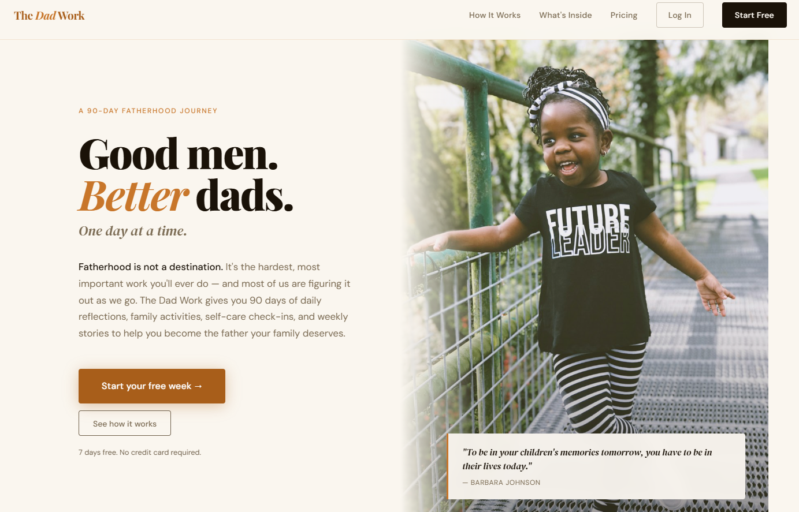
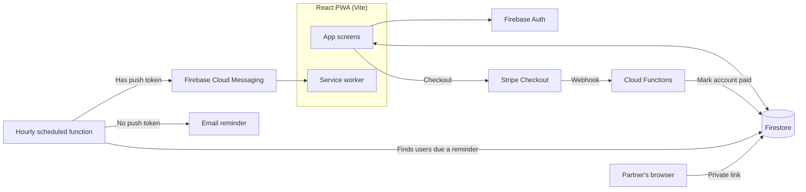

# The Dad Work

A progressive web app that fathers through a 90-day fatherhood journey with daily personalized content, streaks, and partner involvement.

**[Visit thedadwork.com →](https://thedadwork.com)**

> **The source code is private** because this is a live commercial product. This repository documents the architecture, key technical decisions, and features. I'm happy to walk through the code in an interview.

## My role

Founder and sole developer. I designed, built, and launched the product end to end: data model, frontend, backend functions, payments, and notifications.

## The problem

Most parenting apps are built for moms. Dads have few practical, day-by-day resources written for them.

## Features

- **Daily personalized content** that uses each child's name throughout
- **Streak tracking** to build a daily habit
- **Partner Mode** so a partner can connect to the family's journey
- **Push notifications** with an email fallback for iOS
- **Weekly digest emails**, kid profiles, seasonal content packs, and a year-end PDF keepsake
- **Installable PWA** with an Android install prompt
- **Free trial, then a one-time unlock** through Stripe

## Architecture

More detail in [docs/architecture.md](./docs/architecture.md).

## Key technical decisions

- [Partner Mode uses a two-step token lookup](./docs/decisions/001-partner-mode-token-lookup.md)
- [Push notifications with an email fallback for iOS](./docs/decisions/002-push-with-email-fallback.md)

## Accessibility and security

- Built to WCAG 2.1 AA: 4.5:1 text contrast, full keyboard navigation, visible focus states, and 44×44px minimum touch targets
- Audited the production build for leaked secrets before launch

## Tech stack

React · Vite · Firebase (Auth, Firestore, Hosting, Cloud Functions) · Firebase Cloud Messaging · Stripe · EmailJS

## Author

**Brenton Hippler:** [Portfolio](https://brentoncodes.dev) · [LinkedIn](https://www.linkedin.com/in/brenton-hippler-818b6397)