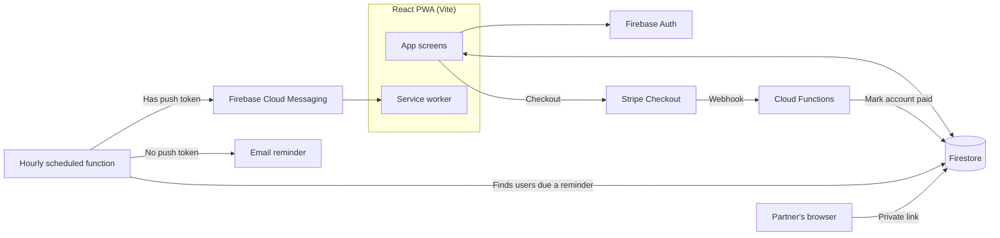

# Architecture

The Dad Work is a React progressive web app backed by Firebase. Most reads and writes go straight from the app to Firestore, protected by security rules. Anything that needs a secret or has to run on a schedule, like payment verification and daily reminders, runs in Cloud Functions.

## Frontend

- **React + Vite**, using ES modules throughout.
- **Firebase v9 modular SDK,** so the bundle only includes the Firebase services the app actually imports. That matters for a PWA that should load fast on a phone.
- **An auth context** holds the signed-in user, their Firestore profile, and every action that changes them (sign-in, onboarding, Partner Mode settings). Components call those actions instead of talking to Firestore directly, which keeps data logic in one place.
- **Installable PWA** with a service worker for push notifications. Android users get a branded install banner using the browser's `beforeinstallprompt` event. iOS doesn't support that event, so the Settings and Support pages walk iPhone users through installing from Safari.

## Data model (high level)

| Collection | Purpose |
| --- | --- |
| `users/{uid}` | Profile, kids, program progress, streaks, reminder preferences, Partner Mode settings |
| `users/{uid}/wins` | The dad's logged "Dad Wins" |
| `users/{uid}/milestones` | Private milestone journal entries |
| `partnerTokens/{token}` | Maps a Partner Mode link to a user (see [ADR 001](./decisions/001-partner-mode-token-lookup.md)) |
| Community posts | Anonymous shared wins, with likes |

## Program progress

The program is 90 days of personalized content, and progress is based on **content completed, not calendar days.**

- A dad who misses a day picks up where he left off instead of losing content.
- After finishing a day, the dashboard keeps showing it as complete until midnight **in his own timezone**, then moves to the next day.
- Streaks count consecutive days of completed content. A missed day resets the streak to 1, not 0, so coming back still counts as a win.
- The dashboard derives everything it shows from the user's Firestore document rather than copying it into local component state. An early version stored "completed today" in `useState`, and it was lost on refresh. Reading from one source of truth fixed it.

## Free trial and payments

1. New users get a **7-day free trial based on content,** not the calendar. The paywall appears after they finish day 7's content, so someone who starts slowly still gets all seven days.
2. The paywall sends them to **Stripe's hosted checkout.** No card data ever touches the app.
3. Stripe calls a **webhook Cloud Function,** which verifies the event came from Stripe and marks the account as paid in Firestore.
4. A **backup verify function** runs from the payment success page, in case the webhook is delayed.
5. Dads who finish the program can **restart** with a new payment. Their progress resets to day 1, and their past wins and milestones are kept.

The Stripe secret key and webhook signing secret are stored in Firebase Secret Manager and only read inside Cloud Functions. They never appear in the frontend bundle or the codebase.

## Daily reminders

An hourly scheduled function sends each user a reminder at their chosen time, by push notification when possible and by email otherwise. See [ADR 002](./decisions/002-push-with-email-fallback.md).

## Partner Mode

A dad can share a read-only view of his progress with his partner through a private link. The partner doesn't need an account. See [ADR 001](./decisions/001-partner-mode-token-lookup.md).

## Security

- **Firestore rules deny everything by default.** Each collection explicitly allows only what it needs, and users can only write their own data.
- **Server-side secrets live in Secret Manager.** Only public-by-design client values (Firebase config, Stripe publishable key, the EmailJS public key with domain restrictions) reach the browser.
- **Pre-launch bundle audit:** I scanned the production build for leaked keys and credentials before launch and found none.
- **Service worker config is generated at build time.** Service workers can't read Vite's `import.meta.env`, so a build script fills a template with values from environment variables. Nothing is hard-coded in the committed file.

## Accessibility

Every screen was built mobile-first to WCAG 2.1 AA: 4.5:1 contrast for text and 3:1 for UI components, semantic HTML, full keyboard navigation, visible focus states, labeled controls, and 44×44px minimum touch targets.

## Hosting

Firebase Hosting serves the app on a custom domain, with Cloud Functions deployed alongside it.